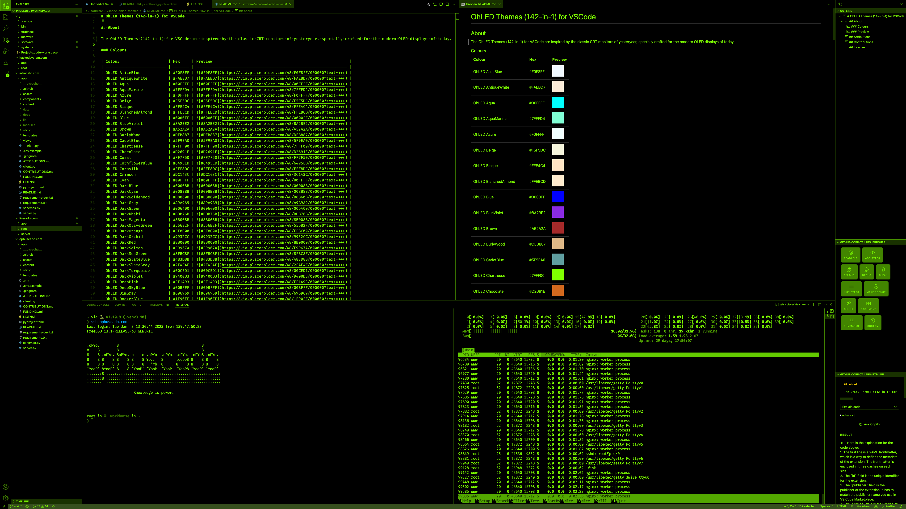
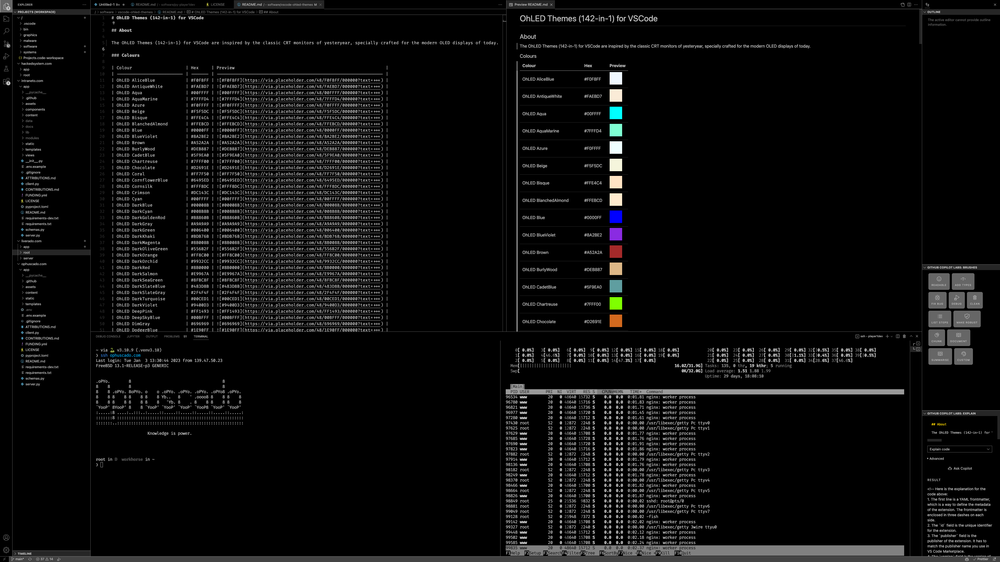
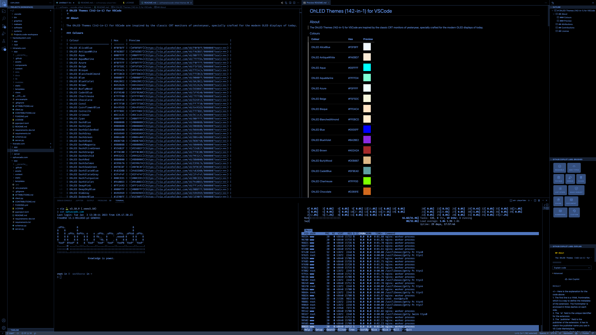
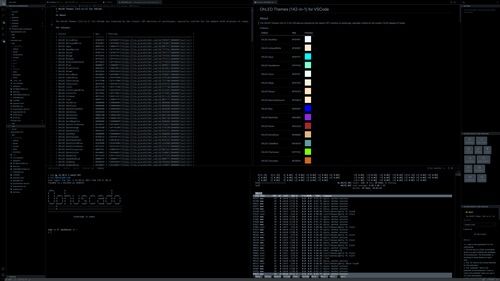
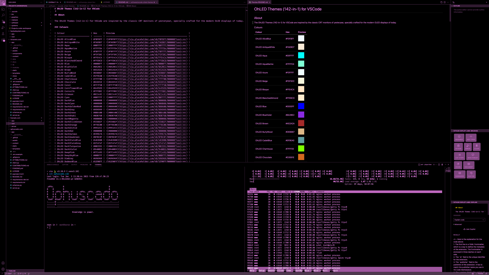
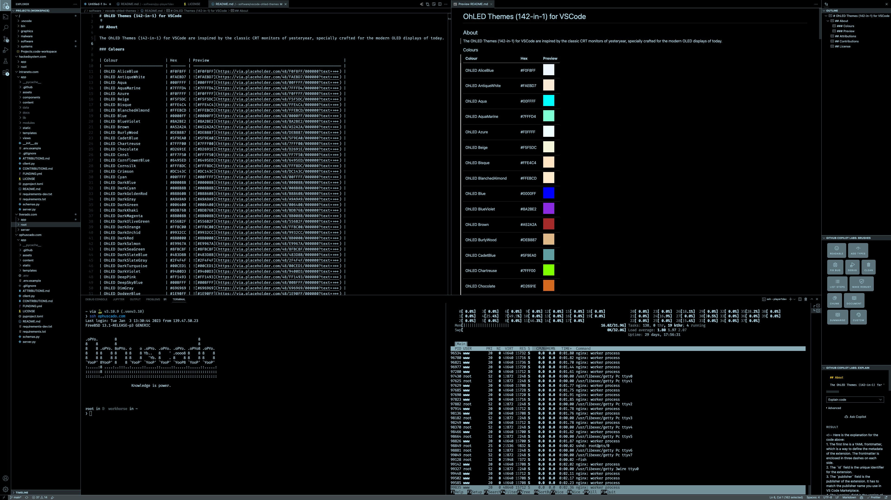
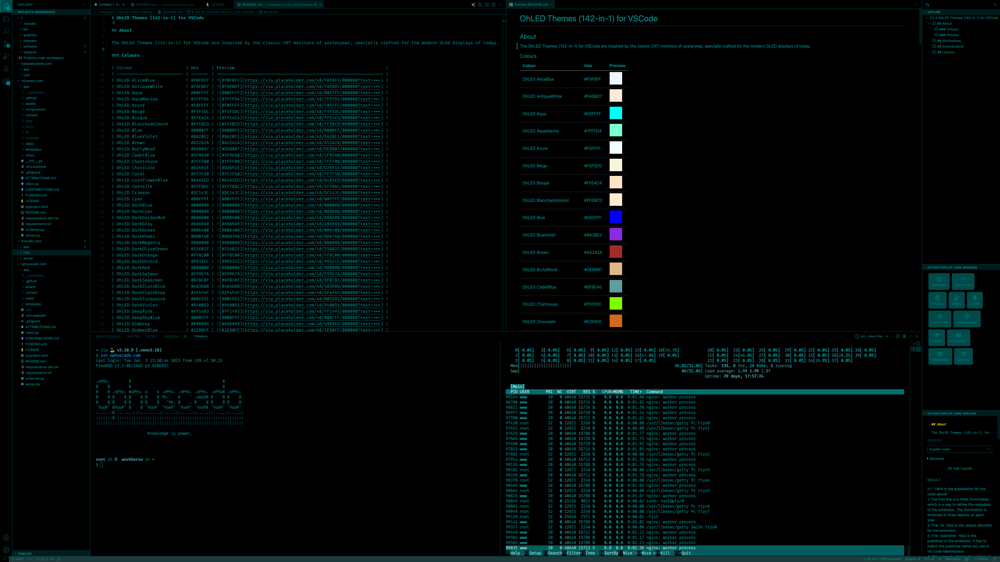
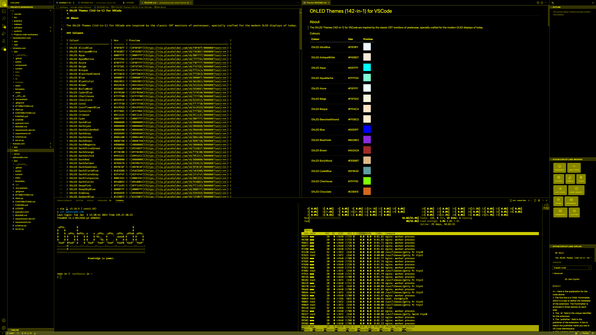
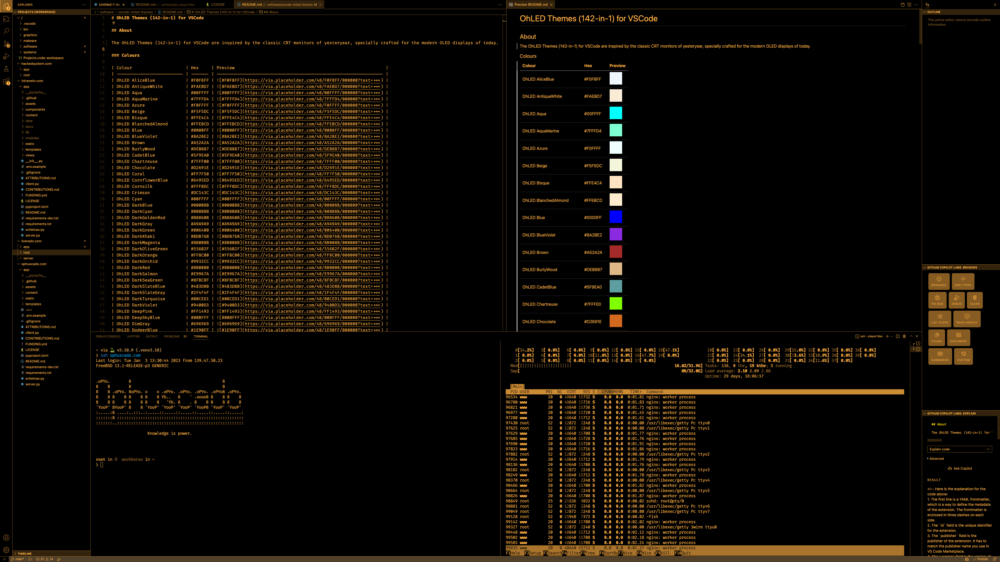
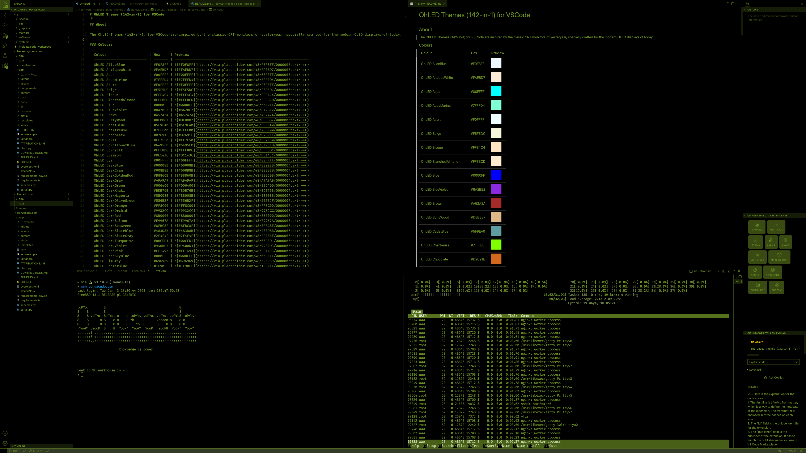

# OhLED Themes (142-in-1)

142 monochrome colour themes for Visual Studio Code. Each theme draws the
whole interface, the editor and the terminal with a single colour on a pure
black background, in the style of classic CRT monitors: black pixels stay
off on an OLED display, and everything else is that one colour at a few
levels of brightness.



<details>
<summary>More previews</summary>



















</details>

## Features

- One colour per theme: every interface and syntax colour is derived from it.
- Syntax highlighting by brightness and weight instead of hue: comments and
  keywords are dimmed, the names of functions, types and tags are bold.
- Dimmed text keeps a contrast of at least 3:1 against the background in
  every theme, line numbers at least 2:1.
- The integrated terminal shows the ANSI colours as brightness levels of the
  same colour.

## Install

The extension identifier is `ophuscado.ohled-themes`.

- In VS Code, open the Extensions view, search for `OhLED Themes` and select
  **Install**, or
- open Quick Open (`Ctrl+P`, `Cmd+P` on macOS) and run
  `ext install ophuscado.ohled-themes`, or
- from a shell: `code --install-extension ophuscado.ohled-themes`.

Then open the Command Palette (`Ctrl+Shift+P`, `Cmd+Shift+P` on macOS), run
**Preferences: Color Theme** and pick a theme. The same choice in
`settings.json`:

```json
{ "workbench.colorTheme": "OhLED_Green" }
```

## Themes

A theme is listed in the picker as `OhLED_` followed by its name below, for
example `OhLED_AliceBlue`. The background is always `#000000`.

<!-- themes:start -->
| Theme | Colour | Theme | Colour | Theme | Colour |
| --- | --- | --- | --- | --- | --- |
| AliceBlue | `#f0f8ff` | AntiqueWhite | `#faebd7` | Aqua | `#00fff0` |
| AquaMarine | `#7fffd4` | Azure | `#f0ffff` | Beige | `#f5f5dc` |
| Bisque | `#ffe4c4` | BlanchedAlmond | `#ffeac7` | Blue | `#5e5eff` |
| BlueViolet | `#964de8` | Brown | `#b45959` | BurlyWood | `#deb887` |
| CadetBlue | `#5f9ea0` | Chartreuse | `#7fff00` | Chocolate | `#d2691e` |
| Coral | `#ff7f50` | CornflowerBlue | `#6495ed` | Cornsilk | `#fff8dc` |
| Crimson | `#de2946` | Cyan | `#00ffff` | DarkBlue | `#6e6ead` |
| DarkCyan | `#008b8b` | DarkGoldenRod | `#b8860b` | DarkGray | `#a9a9a9` |
| DarkGreen | `#527f52` | DarkKhaki | `#bdb76b` | DarkMagenta | `#a25aa2` |
| DarkOliveGreen | `#697b4f` | DarkOrange | `#ff8c00` | DarkOrchid | `#a151ca` |
| DarkRed | `#a66262` | DarkSalmon | `#e9967a` | DarkSeaGreen | `#8fbc8f` |
| DarkSlateBlue | `#746ea3` | DarkSlateGray | `#677878` | DarkTurquoise | `#00ced1` |
| DarkViolet | `#a249dc` | DeepPink | `#ff1493` | DeepSkyBlue | `#00bfff` |
| DimGray | `#747474` | DodgerBlue | `#1e90ff` | FireBrick | `#be5252` |
| ForestGreen | `#228b22` | Fuchsia | `#ff00dd` | Gainsboro | `#dcdcdc` |
| GhostWhite | `#f8f8ff` | Gold | `#ffd700` | GoldenRod | `#daa520` |
| Gray | `#808080` | Green | `#288628` | GreenYellow | `#adff2f` |
| HoneyDew | `#f0fff0` | HotPink | `#ff69b4` | IndianRed | `#cd5c5c` |
| Indigo | `#806aa3` | Ivory | `#fffff0` | Khaki | `#f0e68c` |
| Lavender | `#e6e6fa` | LavenderBlush | `#fff0f5` | LawnGreen | `#70f000` |
| LemonChiffon | `#fffacd` | LightBlue | `#add8e6` | LightCoral | `#f08080` |
| LightCyan | `#e0ffff` | LightGoldenRodYellow | `#fafad2` | LightGray | `#d3d3d3` |
| LightGreen | `#90ee90` | LightPink | `#ffb6c1` | LightSalmon | `#ffa07a` |
| LightSeaGreen | `#20b2aa` | LightSkyBlue | `#87cefa` | LightSlateGray | `#778899` |
| LightSteelBlue | `#b0c4de` | LightYellow | `#ffffe0` | Lime | `#00ff00` |
| LimeGreen | `#32cd32` | Linen | `#faf0e6` | Magenta | `#ff00ff` |
| Maroon | `#9f6565` | MediumAquaMarine | `#66cdaa` | MediumBlue | `#6666e0` |
| MediumOrchid | `#ba55d3` | MediumPurple | `#9370db` | MediumSeaGreen | `#3cb371` |
| MediumSlateBlue | `#7b68ee` | MediumSpringGreen | `#00fa9a` | MediumTurquoise | `#48d1cc` |
| MediumVioletRed | `#cc388d` | MidnightBlue | `#717199` | MintCream | `#f5fffa` |
| MistyRose | `#ffe4e1` | Moccasin | `#ffe4b5` | NavajoWhite | `#ffdead` |
| Navy | `#6b71a1` | OldLace | `#fdf5e6` | Olive | `#808000` |
| OliveDrab | `#6b8e23` | Orange | `#ffa500` | OrangeRed | `#ff4500` |
| Orchid | `#da70d6` | PaleGoldenRod | `#eee8aa` | PaleGreen | `#98fb98` |
| PaleTurquoise | `#afeeee` | PaleVioletRed | `#db7093` | PapayaWhip | `#ffefd5` |
| PeachPuff | `#ffdab9` | Peru | `#cd853f` | Pink | `#ffc0cb` |
| Plum | `#dda0dd` | PowderBlue | `#b0e0e6` | Purple | `#9c5f9c` |
| RebeccaPurple | `#8566ad` | Red | `#ff0000` | RosyBrown | `#bc8f8f` |
| RoyalBlue | `#476ce2` | SaddleBrown | `#9d6852` | Salmon | `#fa8072` |
| SandyBrown | `#f4a460` | SeaGreen | `#2e8b57` | SeaShell | `#fff3ee` |
| Sienna | `#a86248` | Silver | `#c0c0c0` | SkyBlue | `#87ceeb` |
| SlateBlue | `#7365d1` | SlateGray | `#708090` | Snow | `#fffafa` |
| SpringGreen | `#00ff7f` | SteelBlue | `#4682b4` | Tan | `#d2b48c` |
| Teal | `#128282` | Thistle | `#d8bfd8` | Tomato | `#ff6347` |
| Turquoise | `#40e0d0` | Violet | `#ee82ee` | Wheat | `#f0dbb3` |
| White | `#ffffff` | WhiteSmoke | `#f5f5f5` | Yellow | `#ffff00` |
| YellowGreen | `#9acd32` | YellowOrange | `#ffae42` | YellowPink | `#ffb0b0` |
| YellowPurple | `#ffb0ff` |
<!-- themes:end -->

## Build from source

Node.js 22 or later is required.

```sh
npm ci
npm run build    # themes/*.json, contributes.themes and the list above
npm run package  # builds, then writes ohled-themes-<version>.vsix
```

- `config.themes` in `package.json` maps each theme name to its colour.
- `src/crt.js` is the template that derives a full theme from one colour.
- `src/build.js` generates one file per theme and keeps `package.json` and
  the list in this file in step with `config.themes`.

To add or change a theme, edit `config.themes` and run `npm run build`.

## License

MIT, see [LICENSE](LICENSE).
